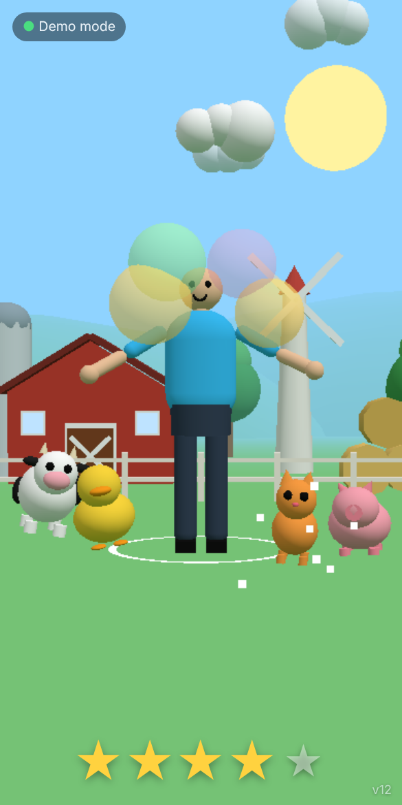
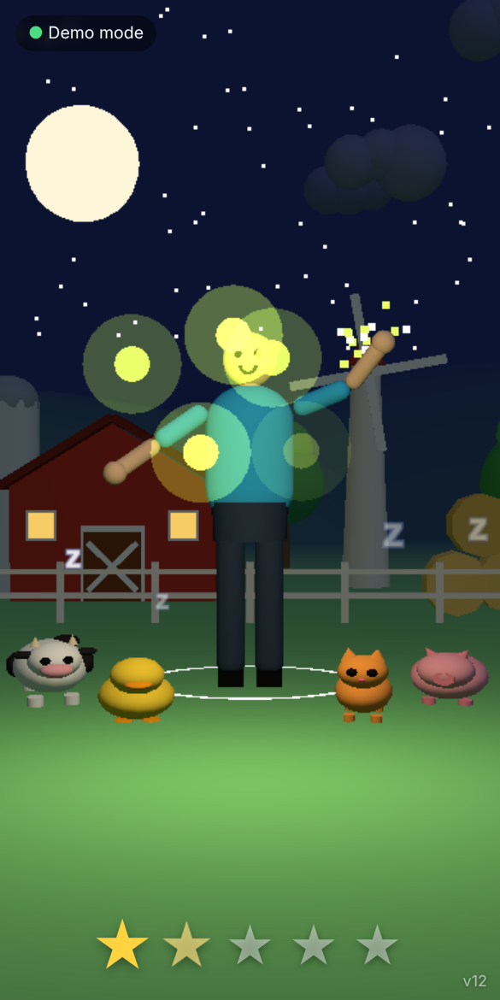

# Fun4two

A tiny 3D game for toddlers where **your own body is the controller**. Point the phone's front camera at your child, and a cartoon avatar on a farm mirrors their arm movements. Pop bubbles, free animals, and watch the day turn into night.

The whole game is a single file, [`index.html`](index.html). No build step, no install, no app store.

| Day | Night |
|---|---|
|  |  |

## Who is it for?

- **Children around 2 years old**, played together with a parent or carer who holds or props up the phone.
- Designed around toddler abilities:
  - **No reading, no text** – everything is shown with pictures, colours and sound.
  - **No losing, no punishment** – every movement gets a happy reaction.
  - **Big arm movements only** – no precise aiming or fine motor control.
  - **Instant feedback** – each touch gives a sound and sparkles within a fraction of a second.

## How to play

1. Open the page on your phone (see [Running it](#running-it)) and tap **Start camera**. Allow camera access.
2. Stand or sit back so the head, shoulders and both arms are in the front camera's view. A small mirrored preview with a green skeleton shows what the game sees.
3. Move your arms. The avatar copies you like a mirror: raise your right arm and the avatar's right arm (on the left of the screen) goes up.

There is also a **Demo without camera** button that makes the avatar wave on its own.

## Game mechanics

### Day (about 60 seconds)
- **Bubbles** float near the avatar's hands. Touch one with a hand to pop it, with sparkles and a random pleasant note.
- **Animal bubbles:** about half the bubbles hold a little animal (duck, pig, cow or cat). Popping one frees it, and it lands on the meadow with a hop and its sound.
- **Meadow friends:** freed animals stay on the grass (up to 8; the oldest leaves when it's full). They hop now and then, and when the child **waves or moves their arms a lot, the animals dance**.
- **Tap an animal** on the screen to make it hop and speak.

### Stars and celebrations
Every pop or catch lights one of five stars at the bottom. The fifth star sets off a celebration:
- **During the day:** a rainbow grows over the farm, confetti rains and all the animals party.
- **At night:** five fireworks shoot up and burst, each lighting up the whole sky.

### Sunset and night (about 10s + 30s)
- The sky turns orange, then dark blue. The sun sets behind the hills, the moon and stars come out, and the barn windows glow. A soft lullaby plays once.
- **Fireflies** replace the bubbles. Touch one to catch it (bell chime, and a star).
- **Sleepy animals:** the meadow animals lie down and little "z"s float up. They don't dance at night.
- **Wake up the sun:** in the last 10 seconds of the night a sun icon appears. Big arm movements make it grow, and when it's full the sun rises, the animals wake up and a new day starts. If the child doesn't wave, the sun rises on its own.

### How the arms are tracked
The page uses [MediaPipe Pose](https://ai.google.dev/edge/mediapipe/solutions/vision/pose_landmarker) to find the shoulders, elbows and wrists in 3D, then points each arm segment of the avatar in the same direction. Arms that leave the camera view relax back to the sides.

## Running it

- **GitHub Pages (easiest):** https://bubbad.github.io/Fun4two/
- **Locally:** run `python3 -m http.server` in this folder and open `http://localhost:8000`. Phone browsers only allow the camera on **HTTPS pages or `localhost`**, so to try it on a phone from your computer you need an HTTPS tunnel (for example `cloudflared` or `ngrok`).
- An internet connection is needed: three.js, MediaPipe and the pose model are loaded from CDNs.

**Privacy:** pose tracking runs on the device. The camera image is not recorded or sent anywhere.

## Tech

- Single HTML file, plain JavaScript modules, no build tooling.
- [three.js](https://threejs.org/) 0.160 for 3D rendering. The avatar, animals and farm are built from simple shapes.
- [MediaPipe Tasks Vision](https://www.npmjs.com/package/@mediapipe/tasks-vision) 0.10.14 (pose landmarker, lite model).
- All sounds are generated live with the Web Audio API, so there are no audio files.
- Made to run on phones: simple shading, pose tracking at about 20 updates per second, and the render resolution lowers itself automatically if the phone is slow.

## Tuning

Timings and sensitivity are plain constants in `index.html`:
- `DAY_T`, `SUNSET_T`, `NIGHT_T`, `WAKE_AT`, `SUNRISE_T` – lengths of the day, sunset, night, wake-up window and sunrise (seconds).
- `waveE > 0.6` – how big an arm movement has to be to count as waving.
- `MAX_BUBBLES`, `SLOTS` – number of bubbles and meadow spots.

## Version

The current build number is shown in the bottom-right corner of the game, so you can tell which commit the Pages site is serving. It goes up by 1 with every commit.
